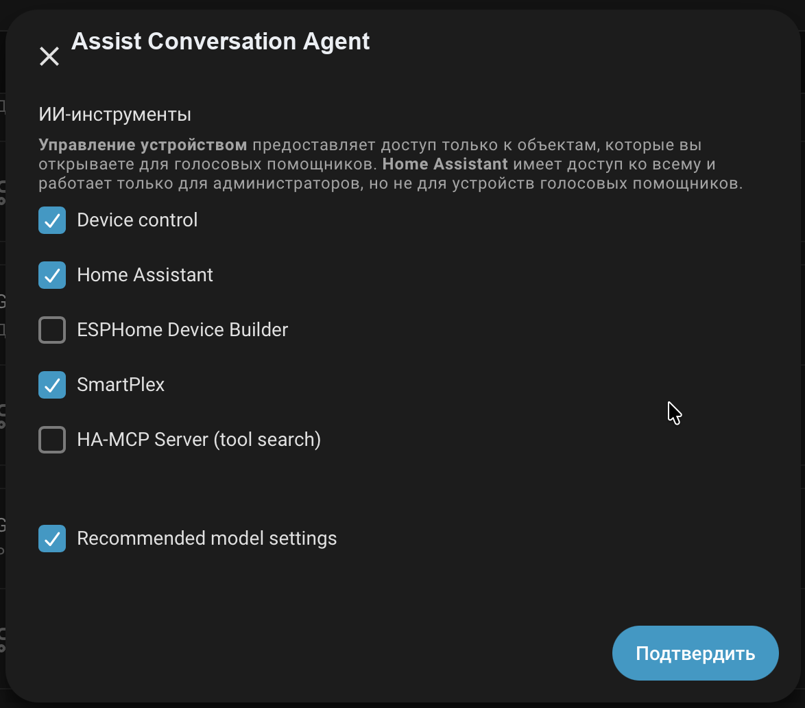
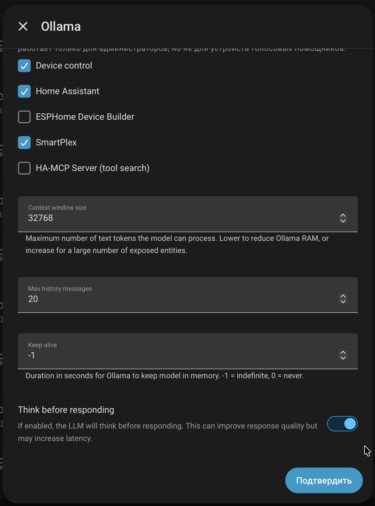
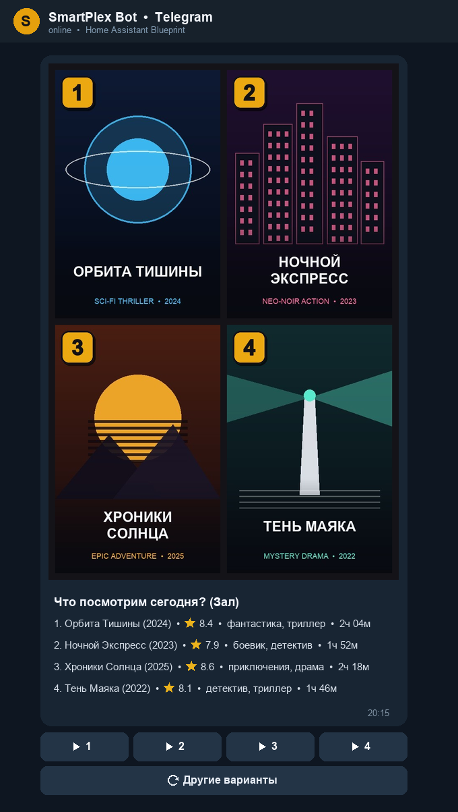
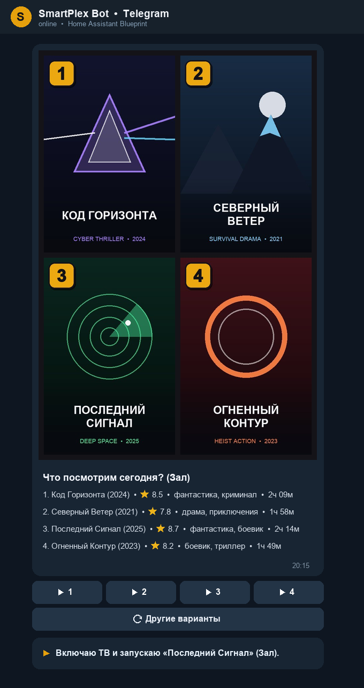
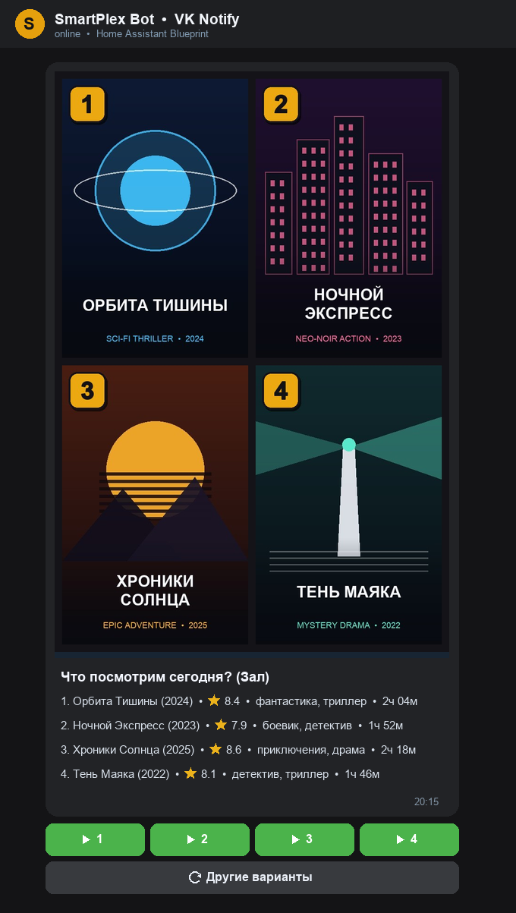
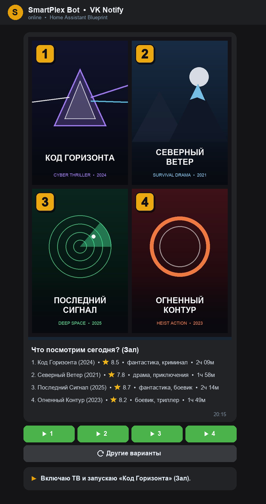
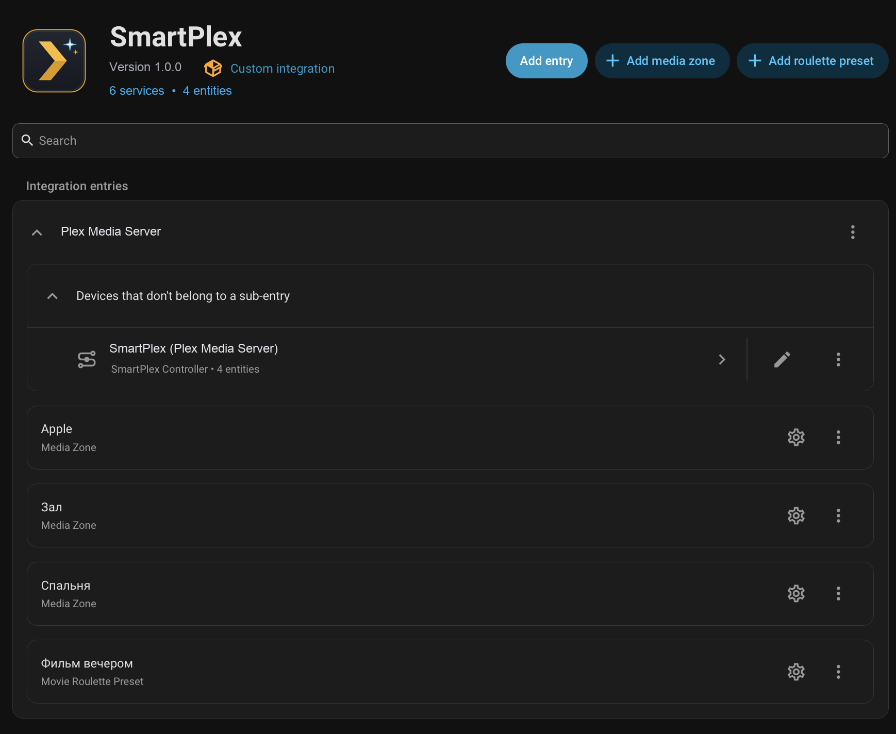

  

<h1 align="center">SmartPlex Integration for Home Assistant</h1>
<h3 align="center">Smart Plex Media Server Orchestration, TV Wake Pipeline, Assist LLM API & Movie Roulette</h3>

  
  
  
  
  

  <a href="README.md">🇷🇺 Русский</a> | <b>🇬🇧 English</b>

**SmartPlex (`plex_smart`)** is a custom integration for **Home Assistant (2026.9+)** that combines **Plex Media Server (OpenAPI v1.2.3)**, multi-phase physical TV / streaming-box / AVR boot orchestration, native **Assist LLM API** tools, seamless cross-room playback handoff, and a **Movie Roulette** poster collage generator for **Telegram** and **VK Notify**.

---

## 📋 Prerequisites

Before installing **SmartPlex**, make sure you have:

1. **Plex Media Server** (`v1.41+ / v1.43+`) running on your network with your movie, TV show, or music libraries.
2. **Home Assistant's built-in [Plex Media Server](https://www.home-assistant.io/integrations/plex/) integration installed and configured** — **required!** It provides the `media_player.plex_*` client entities, real-time WebSocket session updates, and `PlayQueue` builders, while allowing SmartPlex to auto-discover your URL, `X-Plex-Token`, and `button.*_scan_clients` in 1 click.
3. **Your TV or streaming-box integration in Home Assistant** (*LG webOS TV*, *Apple TV*, *Samsung Smart TV*, *Android TV Remote*, etc.) — used to wake powered-off hardware (Wake-on-LAN / Companion), launch the Plex app, switch HDMI inputs, and power off the previous room's TV during handoff.
4. **An AI Agent (optional, depends on how you control Plex):**
   * **For Voice / Assist Chat:** any tool-capable conversation agent (**Google Gemini**, **OpenAI**, **[Yandex AI Studio](https://github.com/Eugen417/HA-Yandex-generative_ai_conversation)**, **[Sber GigaChat AI](https://github.com/Eugen417/HA-GigaChat-generative_ai_conversation)**, **Ollama**).
   * **Zero AI mode:** `plex_smart.play`, `plex_smart.handoff`, `plex_smart.spin_roulette`, and exact movie/episode commands in `plex_smart.command` work **100% locally without any AI**.
   * **For fuzzy natural-language queries in YAML automations:** any `ai_task.*` entity.

---

## 🧠 How AI Works in SmartPlex: Assist vs AI Task (Important!)

During server setup, you will see an optional field **“AI Task entity for `plex_smart.command`”**. SmartPlex works completely **even if you leave this field empty** — which mechanism runs depends on how you trigger commands:

| Control Method | Is `AI Task` Needed? | How It Works |
| :--- | :---: | :--- |
| 🎙 **Home Assistant Assist** *(voice satellites, HA chat, mobile app)* using **Google Gemini**, **OpenAI**, **[Yandex AI Studio](https://github.com/Eugen417/HA-Yandex-generative_ai_conversation)**, **[Sber GigaChat AI](https://github.com/Eugen417/HA-GigaChat-generative_ai_conversation)**, or **Ollama** | ❌ **NOT needed** *(never called)* | Simply enable **SmartPlex** in your Assist conversation agent's *LLM Tools* settings. Your conversation agent directly calls `plex_smart_play`, `plex_smart_control`, `plex_smart_transfer_or_resume`, and `plex_smart_search` with zero extra LLM hops. |
| ⚡ **Direct title, handoff & playback controls in `plex_smart.command`** *(`"play Interstellar"`, `"pause"`, `"seek to 30 minutes"`, `"move movie to bedroom"`)* | ❌ **NOT needed** *(`0` tokens, `< 1 ms`)* | Built-in local resolvers handle exact titles/episodes, room-to-room handoff, pause, seek, repeat, and shuffle directly in RAM without calling any LLM. |
| 🤖 **Fuzzy natural-language text in `plex_smart.command` from YAML automations / scripts / buttons** *(`"play a fresh 90s comedy"`)* | ✅ **Yes, used here** | Because plain YAML automations do not run inside an Assist conversation agent, `plex_smart.command` calls your configured `ai_task.*` entity to translate free-form text into structured Plex filters. |

> 💡 **Tip for cloud LLM safety filters:**
> Some cloud LLM providers enforce strict content filters by default and may reject harmless action/crime movie titles mentioning weapons or crime (e.g. *“War Dogs”*, *“Lord of War”*, *“Kill Bill”*) with a `SAFETY` block. If your agent blocks innocent titles, lower its safety threshold (e.g. `Block none`) in the agent's Home Assistant configuration.

### 🎓 Recommended LLM Tier Guide (by Capability, Not Brand)

SmartPlex is provider-agnostic — pick your LLM based on **tool-calling reliability, world knowledge, and voice latency**:

| Capability Tier | Typical Scale | What Works Reliably in SmartPlex | Trade-offs & Notes |
| :--- | :--- | :--- | :--- |
| **0️⃣ Zero-LLM (`0B`)** | Built-in SmartPlex local resolvers (`< 1 ms`, `0` tokens) | Exact movie, TV show, season/episode, and playlist titles; bidirectional room handoff; pause, unpause, relative/absolute seek, restart `0:00`, repeat, and shuffle. | 100% local and instant, but does not interpret plot summaries or open-ended discovery prompts. |
| **1️⃣ Compact / Entry-Level** | Local `3B–8B` (quantized) or entry-level lightweight cloud models without reasoning | Simple single-step `plex_smart_play` calls by title, single genre, or single actor. | Prone to franchise title hallucinations, dropping `resume=true` *(mitigated by SmartPlex's `ChatLog` guard)*, and weak multi-actor filmography knowledge. **Not recommended** for complex queries. |
| **2️⃣ Balanced Mid-Tier ⭐** *(recommended sweet spot)* | Local `14B–32B` (`Q4_K_M` / `Q6_K`) with native **Tool Calling**, or fast mid/pro-tier cloud models (`< 2 s`) | Strict JSON schema adherence across all 4 tools, clean `START` / `RESUME` / `HANDOFF` / `CONTROL` routing, bilingual multi-actor lists (`actors` + `candidate_titles`), and director/era filters. | Best balance of intelligence and low latency for responsive voice assistants. |
| **3️⃣ Frontier / Reasoning** | Large `70B+` / MoE or reasoning-capable models | Maximum cinema knowledge: plot-based lookups (*“that sci-fi time-loop war movie…”*), obscure indie titles, and complex multi-constraint queries. | For live voice satellites, configure **low / minimal thinking effort** to avoid `10–20 s` spoken delays. |

  
  &nbsp;
  

---

## ✨ Key Features

* ⚡ **1-Click Plex Discovery:** Automatically detects your existing Home Assistant `plex` integration and pre-fills your local URL, `X-Plex-Token`, and `button.*_scan_clients` entity (manual setup is also supported).
* 📺 **Hardware-Aware Media Zones (`ConfigSubentry`):**
  * **Built-in Power Profiles:** **LG webOS** *(races `play_media` against WebSocket state events to bypass `plexapi`'s 30s proxy `ReadTimeout` without restarting playback)*, **Apple TV** *(bypasses closed port `32500` on Plex tvOS `2026.20+` via `plex://libraries/.../unmatched/...` deep links, `/:/timeline` + `/:/unscrobble` sync, and auto `select`)*, **Samsung Tizen** *(Wake-on-LAN via `media_player`, App ID `3201512006963`, and ~30s cold app boot handling)*, **Android TV / Google TV / Shield**, **Standard Media Player**, and **Custom Actions (`ActionSelector`)**.
  * **Primary Room Player (`is_default`) + Paired Display/AVR:** designates the default player when multiple devices share one room, wakes a paired TV/projector/AVR (`display_device_id` + `display_source`) in parallel, and runs **3-Phase Boot Timings** (❄️ *Cold* / 🌤 *Warm* / 🔥 *Hot*).
* 🎬 **Canonical `PLAY` vs `RESUME` Media Templates (`payload_templates.py`):**
  * **Movies (`movie`):** `play` starts from `0:00`; `resume` queries live `viewOffset` directly from PMS (`GET /library/metadata/{id}`) — bypassing the 60-minute cache — and guards saved timestamps (`saved_resume_offsets`) against accidental overwrite.
  * **TV Shows, Seasons & Episodes (`show` / `season` / `episode`):** includes `"continuous": 1` for auto-advancing `PlayQueue` playback. Starting a show launches `S01E01` (skipping `Season 00` Specials); resuming picks the exact `Continue Watching` / in-progress episode.
  * **Music & Audiobooks (`music`):** play by artist, album, **standalone song/track even without naming the artist** (`track`), or genre/mood/decade (`album.decade`), with track-level resume for audiobooks and podcasts.
* 🤝 **Multi-Actor `AND` Intersection & Similar Titles (`similar_to`):**
  * Strict cast intersection (`actor 1 ∩ actor 2 ∩ director`) across both local cache and full PMS DB (`async_intersect_people`) with bilingual & inflected name matching + `candidate_titles` cross-check.
  * Native `GET /library/metadata/{id}/similar` support (*“play something similar to The Gentlemen”*).
* 🔄 **Seamless Bidirectional Cross-Room Handoff (`plex_smart.handoff`):** Say *“Move the movie from living room to bedroom”* or *“Switch it back to the living room”* — SmartPlex captures the live position before power-off, **turns off the previous TV**, wakes the target TV, and resumes from the exact timestamp (with a 5-second overlap rewind and strict per-zone `machine_id` session isolation).
* ⏯ **Hardware-Aware Playback Control & Seek (`plex_smart.control`):** *pause*, smart *resume* (unpauses in-place without restarting from `0:00`), *stop*, *seek forward/backward (±5–10s / N min)*, *jump to timestamp* (*“seek to minute 30”*), *restart from `0:00`*, *next/previous*, *repeat (`off`/`one`/`all`)*, and *shuffle*. Full command catalog & YAML examples: **[📖 Commands Reference (`docs/COMMANDS.en.md`)](docs/COMMANDS.en.md)**.
* 🎲 **Configurable Movie Roulette (`plex_smart.spin_roulette`):** Renders a numbered `Pillow` poster collage via an internal HTTP view (`roulette.image_url` — no `allowlist_external_dirs` needed and zero Plex token exposure), returns native inline keyboards for **Telegram Bot** (`telegram_inline_keyboard`) and **VK Notify** (`vk_keyboard`), and ships with 1-click **HA Blueprints** in [`blueprints/automation/Eugen417/`](blueprints/automation/Eugen417/) plus YAML examples in [`examples/en/`](examples/en/README.md).
* 🔒 **Privacy & Localization:** Neutral replies in your Home Assistant language (EN / RU) with an optional custom greeting (`user_title`), plus automatic redaction of tokens, LAN IPs, and `*.plex.direct` hosts in logs and diagnostics (`privacy.py`, `diagnostics.py`).

---

## 🍿 Interactive Movie Roulette Showcase (Telegram & VK Notify Blueprints)

`plex_smart.spin_roulette` and the included Home Assistant Blueprints in [`blueprints/automation/Eugen417/`](blueprints/automation/Eugen417/) send a 2×2 poster collage of unwatched movies with anti-repeat tracking and `▶ 1..4` + `🔄 Reroll` buttons (zero Plex token exposure and no `allowlist_external_dirs` setup).

### Telegram (`Telegram Bot`)

  
  &nbsp;
  

### VK (`VK Notify`)

  
  &nbsp;
  

---

## 🔧 Platform Workarounds for Apple TV, LG webOS & Samsung Tizen

Modern TV and set-top-box Plex clients suffer from platform quirks that break naive `media_player.play_media` scripts. **SmartPlex** handles them automatically:

### 🍎 Apple TV (`Plex for tvOS 2026.20+`)
* **The Problem:** Starting with Plex for tvOS `2026.20+`, the client closed local Companion port `32500` completely — standard `media_player.plex_*` commands fail with `Connection refused` even while a video is playing.
* **How SmartPlex Solves It:**
  1. Launches all Apple TV items via verified tvOS Deep Links (`plex://libraries/{server_id}/unmatched/%2Flibrary%2Fmetadata%2F{rating_key}`) directly on the Apple TV `media_player` entity.
  2. Pre-syncs server playback state via official `/:/timeline` and `/:/unscrobble` endpoints so the tvOS pre-play card reliably highlights *Play* (`0:00`) vs *Resume* (exact timestamp).
  3. Cleanly exits any active video via `menu` before switching titles and auto-sends `select` via `remote.*`.

### 📺 LG webOS (`Plex for LG`)
* **Problem #1 (30-second proxy timeout restarts):** On LG webOS, `plexapi`'s server proxy (`*.plex.direct:32400`) often hangs for 30 seconds after playback starts and raises `Read timed out`, causing naive retry loops to restart the episode mid-scene.
  * **Solution:** SmartPlex races `play_media` against live WebSocket `playing`/`buffering` state events and checks live player state on `TimeoutError`, finishing immediately with zero false retries.
* **Problem #2 (`offset` ignored on Resume + PMS crash on concurrent `seek`):** `Plex for LG` may ignore the initial `offset` parameter in `playMedia` (opening at `0:00`), while sending any `seekTo` command (even manually from Plex Web!) during the open 30-second `playMedia` proxy window crashes Plex Media Server itself.
  * **Solution:** SmartPlex returns an instant voice reply over WebSocket (`~0.5 s`), enforces `RESUME` and room-to-room handoff deterministically from HA's `ChatLog`, refreshes stale cold-start `"idle"` state via `scan_clients`, and **strictly awaits completion of the 30-second `playMedia` proxy task** before issuing a clean integer `seekTo` verified against `/status/sessions` (backed by `saved_resume_offsets` protection).

### 📺 Samsung Tizen (`Plex for Samsung`)
* **The Problem:** Home Assistant's `samsungtv` integration raises an error on `remote.turn_on` unless a manual trigger automation exists, omits Tizen apps from `source_list` (`["TV", "HDMI"]`), `Plex for Samsung` registers with PMS within 5–7s while spending ~25s more on its splash screen (`404`/`500` and 30s `Read timed out`), Tizen's `AVPlay` decoder ignores initial `offset` in `playMedia`, and HA Core's `media_player.media_seek` sends a float `offset=1801000.0` rejected by Tizen.
* **Solution:** SmartPlex wakes Samsung TVs via built-in `media_player.turn_on` Wake-on-LAN (with a repeat WoL pulse for deep-sleep NICs), launches Plex by App ID `3201512006963`, dynamically follows recreated `_2`/`_3` entities, covers the full ~30s boot window, and on *Resume/Handoff* waits for `AVPlay` frame decoding before running a closed-loop verified integer `seekTo` confirmed against `/status/sessions`.

---

## 📦 Installation & Setup

1. Copy `custom_components/plex_smart` into `/config/custom_components/` (or install via **HACS / Marketplace**) and **restart Home Assistant**.
2. Make sure the built-in **Plex Media Server** integration and your TV / streaming-box integrations (*LG webOS*, *Apple TV*, *Samsung*, *Android TV*) are configured in Home Assistant.
3. Go to **Settings → Devices & Services → Add Integration → SmartPlex**:
   * pick your discovered Plex server (URL, `X-Plex-Token`, and `scan_clients` button are filled automatically);
   * optionally set a custom greeting or leave it empty for neutral replies.
4. Inside the **SmartPlex** card, add **Media Zones** (e.g. *Living Room*, *Bedroom*, *Apple TV*) and optional **Movie Roulette Presets**:
   * select the HA Area, `media_player.plex_*` client, power profile, and physical TV/box device;
   * enable **Primary default player (`is_default`)** on your main TV.
5. For voice control, open your **Assist** conversation agent settings and enable **SmartPlex** under LLM Tools.

  

---

## 🛠 Services

| Service | Description |
| :--- | :--- |
| `plex_smart.command` | Natural-language command execution (`< 1 ms` local resolve for exact titles/episodes, handoff, pause & seek, or via `ai_task.*` for fuzzy automation queries). |
| `plex_smart.play` | Structured start or resume (`resume: true`) for movies, shows, seasons, episodes, tracks, albums, playlists, multi-actor collaborations (`actors`), `similar_to`, and explicit `offset_sec`. |
| `plex_smart.handoff` | Transfer active playback to another media zone (optionally turning off the source TV), resume `Continue Watching`, or unpause in-place. |
| `plex_smart.control` | Control active playback: pause, unpause, stop, restart from `0:00`, relative seek (`seek_relative`), exact timestamp (`seek_to`), `next`/`previous`, repeat (`set_repeat`), and shuffle (`set_shuffle`). |
| `plex_smart.spin_roulette` | Pick filtered movies, render a numbered poster collage, and return Telegram & VK inline keyboards (`SupportsResponse.ONLY`). |
| `plex_smart.refresh_cache` | Immediately re-index all Plex libraries, cast tags, genres, and playlists in memory. |

👉 **Full voice commands & YAML services reference:** [`docs/COMMANDS.en.md`](docs/COMMANDS.en.md) | [`examples/en/README.md`](examples/en/README.md).

---

## 📄 License

Distributed under the [MIT License](LICENSE).
