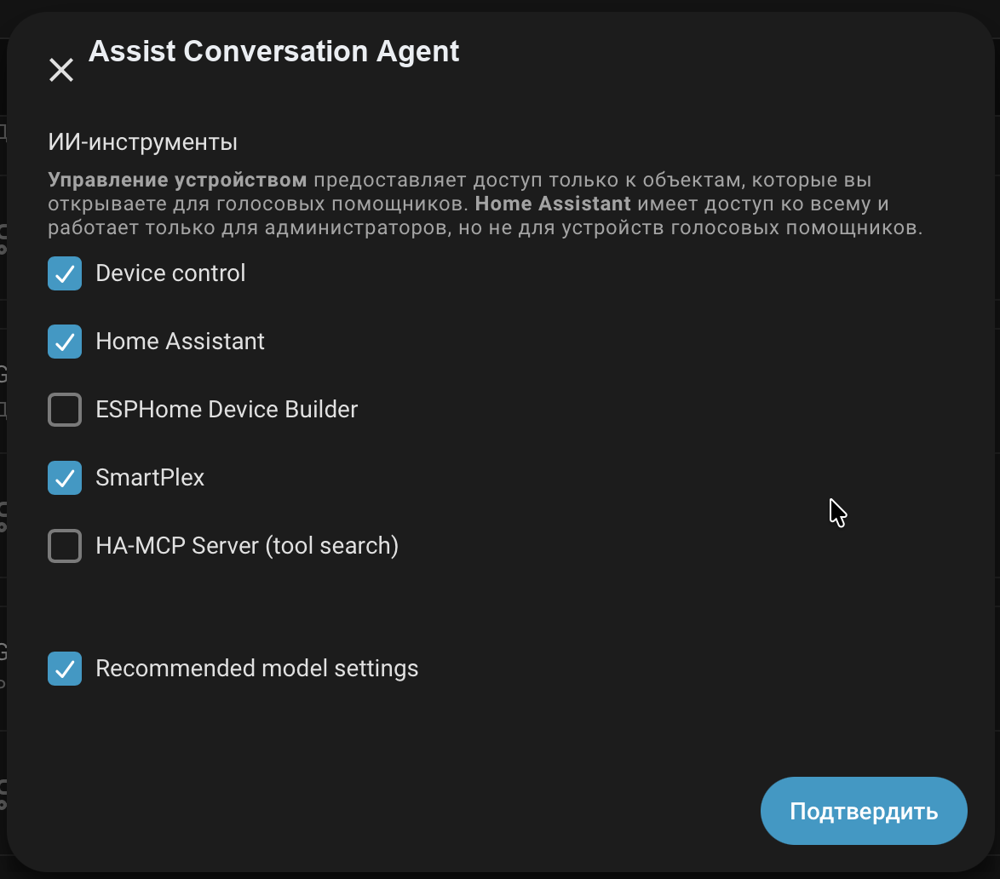
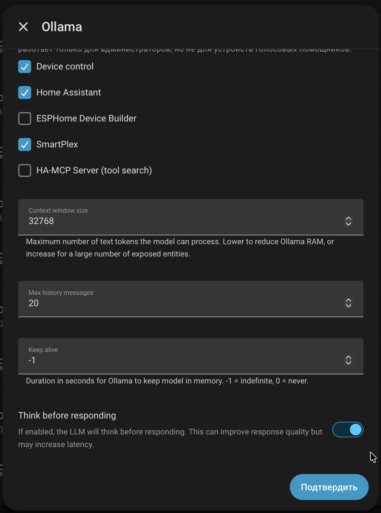
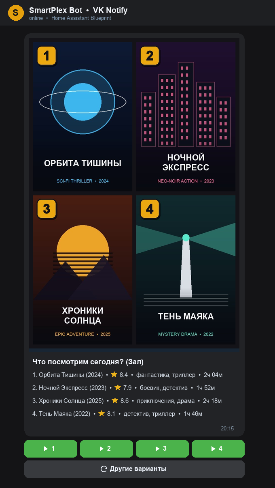
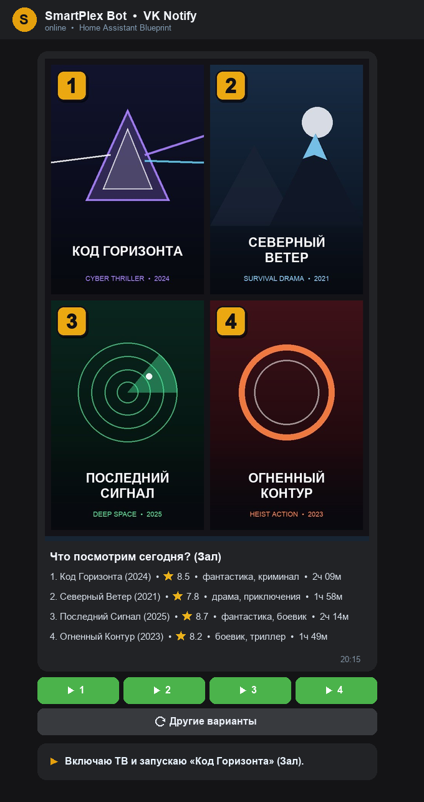
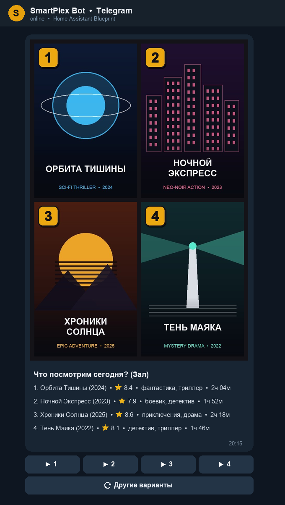
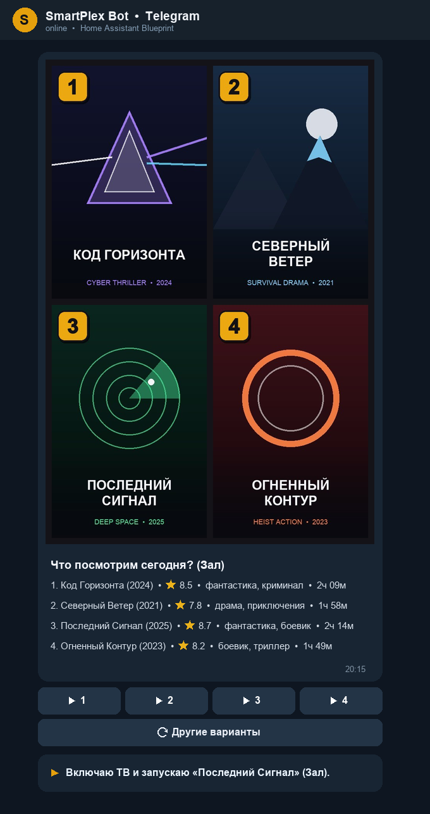
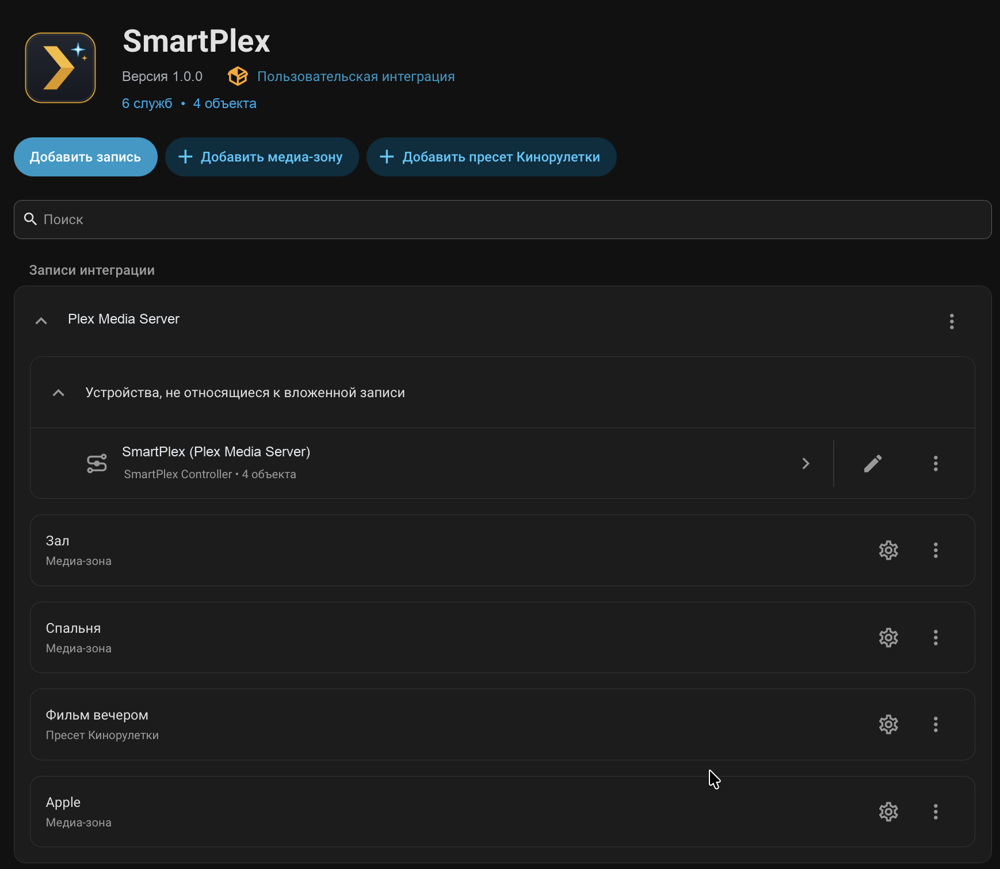

  

<h1 align="center">SmartPlex Integration for Home Assistant</h1>
<h3 align="center">Умная оркестрация Plex Media Server, телевизоров, голосового Assist и Кинорулетки</h3>

  
  
  
  
  

  <b>🇷🇺 Русский</b> | <a href="README.en.md">🇬🇧 English</a>

**SmartPlex (`plex_smart`)** — интеграция для **Home Assistant (2026.9+)**, объединяющая **Plex Media Server (OpenAPI v1.2.3)**, физическое включение телевизоров/приставок/ресиверов, нативные ИИ-инструменты для голосового ассистента **Assist**, бесшовный перенос просмотра между комнатами и генератор коллажей **Кинорулетки** для **VK Notify** и **Telegram**.

---

## 📋 Что необходимо для работы (Требования)

Перед установкой **SmartPlex** убедитесь, что у вас есть:

1. **Сервер Plex Media Server** (`v1.41+ / v1.43+`) в локальной сети с вашими библиотеками фильмов, сериалов или музыки.
2. **Установленная и настроенная штатная интеграция [Plex Media Server](https://www.home-assistant.io/integrations/plex/) в Home Assistant** — **обязательна**! Именно она создаёт в HA клиентские плееры `media_player.plex_*`, держит живой WebSocket-канал с сервером, строит очереди `PlayQueue`, а также позволяет SmartPlex автоматически подставить адрес сервера и кнопку `button.*_scan_clients` при настройке (свой `X-Plex-Token` вы вводите отдельно).
3. **Интеграция вашего телевизора или приставки в Home Assistant** (*LG webOS TV*, *Apple TV*, *Samsung Smart TV*, *Android TV Remote* и т.д.) — нужна для физического пробуждения выключенного экрана (Wake-on-LAN / Companion), автозапуска приложения Plex, переключения HDMI-входа и выключения предыдущего ТВ при переносе просмотра.
4. **ИИ-агент (по желанию, зависит от сценария):**
   * **Для голосового управления и чата Assist:** любой разговорный агент с поддержкой инструментов (**Google Gemini**, **[Yandex AI Studio](https://github.com/Eugen417/HA-Yandex-generative_ai_conversation)**, **[Sber GigaChat AI](https://github.com/Eugen417/HA-GigaChat-generative_ai_conversation)**, **OpenAI**, **Ollama**).
   * **Без ИИ вообще:** сервисы `plex_smart.play`, `plex_smart.handoff`, Кинорулетка `plex_smart.spin_roulette` и прямые названия фильмов/серий в `plex_smart.command` работают **на 100% локально без какого-либо ИИ**.
   * **Для размытых текстовых команд из YAML-автоматизаций:** любая сущность `ai_task.*`.

---

## 🧠 Как работает ИИ в SmartPlex: Assist против AI Task (Важно!)

При подключении сервера Plex вы увидите необязательное поле **«Сущность AI Task (только для сервиса command)»**. Интеграция полностью работает **даже если оставить это поле пустым** — выбор механизма зависит от того, откуда приходит команда:

| Способ управления | Нужен ли `AI Task`? | Как это работает |
| :--- | :---: | :--- |
| 🎙 **Голосовой ассистент Assist** *(колонки, чат HA, телефон)* с агентом **Google Gemini**, **[Yandex AI Studio](https://github.com/Eugen417/HA-Yandex-generative_ai_conversation)**, **[Sber GigaChat AI](https://github.com/Eugen417/HA-GigaChat-generative_ai_conversation)**, **OpenAI** или **Ollama** | ❌ **НЕ нужен** *(не используется)* | Вы просто включаете галочку **SmartPlex** в настройках разговорного агента Assist (*Инструменты ИИ*). Сам агент напрямую вызывает нативные инструменты `plex_smart_play`, `plex_smart_control`, `plex_smart_transfer_or_resume` и `plex_smart_search` без двойного вызова LLM. |
| ⚡ **Прямая команда в `plex_smart.command`** *(`«включи Интерстеллар в зале»`, `«перемотай на 30 минуту»`, `«поставь на паузу»`, `«перенеси фильм в спальню»`)* | ❌ **НЕ нужен** *(`0` токенов, `< 1 мс`)* | Встроенные локальные резолверы мгновенно обрабатывают точные названия фильмов/серий, перенос между комнатами, паузу и перемотку прямо в ОЗУ без обращения к ИИ. |
| 🤖 **Размытая смысловая фраза в `plex_smart.command` из автоматизации / скрипта / кнопки** *(`«включи свежую комедию с Джимом Керри»`)* | ✅ **Да, используется** | У обычной YAML-автоматизации нет своего разговорного агента Assist, поэтому `plex_smart.command` обращается к указанной сущности `ai_task.*`, чтобы перевести свободный текст в JSON-фильтры Plex. |

> 💡 **Совет по настройкам безопасности облачных ИИ-агентов:**
> У некоторых облачных LLM по умолчанию включён строгий цензор, который может блокировать безобидные названия боевиков и комедий со словами об оружии или криминале (*«Парни со стволами»*, *«Оружейный барон»*, *«Убить Билла»*). Если ваш агент отклоняет такие запросы с ошибкой фильтра безопасности (`SAFETY`), снизьте порог фильтрации (например, `Block none`) в настройках агента в Home Assistant.

### 🎓 Какая LLM подойдёт (рекомендации по уровню интеллекта)

SmartPlex не привязан к конкретному провайдеру — выбирайте модель по её **классу, качеству Function / Tool Calling и скорости отклика**:

| Класс модели | Примеры масштаба | Что уверенно умеет в SmartPlex | Особенности и ограничения |
| :--- | :--- | :--- | :--- |
| **0️⃣ Без LLM (`0B`)** | Встроенный движок SmartPlex (`< 1 мс`, `0` токенов) | Точные названия фильмов, сериалов, сезонов, серий и плейлистов; двусторонний перенос между комнатами; пауза, снятие с паузы, перемотка `±сек/мин` и на точную минуту, рестарт `0:00`, повтор, микс. | Работает на 100% локально без интернета и токенов, но не понимает сюжетные описания и размытые смысловые запросы. |
| **1️⃣ Лёгкий (компактный)** | Локальные `3B–8B` (квантованные) или базовые «младшие» облачные модели без reasoning | Простые одношаговые вызовы `plex_smart_play` по названию, жанру или одному актёру. | Склонны путать части франшиз при переводе названий, забывать флаг `resume` *(SmartPlex страхует это перехватом из `ChatLog`)* и слабо знают совместную фильмографию 2+ актёров. **Не рекомендуются** для сложных кинозапросов. |
| **2️⃣ Средний сбалансированный ⭐** *(рекомендуемый оптимум)* | Локальные `14B–32B` (`Q4_K_M` / `Q6_K`) с нативным **Tool Calling** или быстрые облачные модели среднего / профессионального уровня (`< 2 с`) | Чёткое соблюдение JSON-схем всех 4 инструментов, безошибочное разделение `START` / `RESUME` / `HANDOFF` / `CONTROL`, двуязычный подбор 2+ актёров (`actors` + `candidate_titles`) и поиск по эпохе/режиссёру. | Лучший баланс точности и скорости для живых голосовых колонок и чата Assist. |
| **3️⃣ Флагманский / Reasoning** | Крупные модели `70B+` / MoE или модели с режимом рассуждений | Максимальная эрудиция: поиск кино по размытому пересказу сюжета (*«фильм, где герой застрял во временной петле…»*), редкое авторское кино, сложные составные фильтры. | Для голосового управления используйте **быстрый / минимальный бюджет размышлений** (`low / minimal thinking`), чтобы избежать пауз в `10–20 сек` на колонке. |

  
  &nbsp;
  

---

## ✨ Главные возможности

* ⚡ **Быстрая настройка сервера:** находит существующие серверы из штатной интеграции `plex` и подставляет локальный URL, настройку SSL и кнопку `button.*_scan_clients` (также доступен полностью ручной ввод; ваш `X-Plex-Token` вводится вами напрямую и никогда не копируется из других интеграций).
* 📺 **Медиа-зоны (`ConfigSubentry`) под любое железо:**
  * **Профили ТВ и приставок:** **LG webOS** *(гонка `play_media` с WebSocket против 30-секундного `ReadTimeout` прокси `plexapi` и ложных перезапусков)*, **Apple TV** *(обход закрытого порта `32500` в Plex tvOS `2026.20+` через Deep Link `plex://libraries/.../unmatched/...`, синхронизацию `/:/timeline` + `/:/unscrobble` и автонажатие `select`)*, **Samsung Tizen** *(Wake-on-LAN через `media_player`, запуск по App ID `3201512006963` и сопровождение ~30-секундной загрузки плеера)*, **Android TV / Google TV / Shield**, **Стандартный медиаплеер** и **Пользовательские действия (`ActionSelector`)**.
  * **Главное устройство (`is_default`) + Связанный экран:** приоритет основного ТВ при нескольких плеерах в одной комнате, параллельное включение связанного ТВ/проектора/ресивера (`display_device_id` + `display_source`) и **3 фазы старта** (❄️ *Холодный* / 🌤 *Тёплый* / 🔥 *Горячий*).
* 🎬 **Эталонные шаблоны `ВКЛЮЧИ` vs `ПРОДОЛЖИ` для всех типов медиа (`payload_templates.py`):**
  * **Фильмы (`movie`):** `включи` стартует с `0:00`; `продолжи` запрашивает живой `viewOffset` напрямую у Plex (`GET /library/metadata/{id}`), обходя 60-минутный кэш, и защищает сохранённую позицию (`saved_resume_offsets`) от случайного затирания первыми секундами.
  * **Сериалы, сезоны и серии (`show` / `season` / `episode`):** везде передаётся `"continuous": 1` для бесконечной очереди `PlayQueue` с автопереходом к следующим сериям. `включи сериал X` стартует с `S01E01` (пропуская спецвыпуски `Season 00`), а `продолжи сериал X` берёт точный эпизод из `Continue Watching` или недосмотренных.
  * **Музыка и аудиокниги (`music`):** запуск по исполнителю, альбому, **отдельной песне даже без указания артиста** (`track`), жанру/настроению/декаде (`album.decade`), а при `продолжи альбом / аудиокнигу` — продолжение ровно с недослушанной главы и секунды.
* 🤝 **Совместные фильмы 2+ актёров (`AND`) и Похожее кино (`similar_to`):**
  * Строгое пересечение каста (`актёр 1 ∩ актёр 2 ∩ режиссёр`) в кэше и по полной БД Plex (`async_intersect_people`) с пониманием RU/EN имён, падежей и слитного/раздельного написания (*«Ди Каприо» == «ДиКаприо»*) + подстраховка через `candidate_titles`.
  * Нативный поиск похожих фильмов через `GET /library/metadata/{id}/similar` (*«включи что-нибудь похожее на Джентльмены»*).
* 🔄 **Бесшовный двусторонний перенос между комнатами (`plex_smart.handoff`):** скажите *«Перенеси кино из зала в спальню»* или *«Верни фильм обратно из спальни в зал»* — интеграция снимет точную позицию до выключения, **погасит предыдущий ТВ**, разбудит экран в целевой комнате и продолжит с той же секунды (с откатом −5 сек и строгой изоляцией сессий по `machine_id`, чтобы призрачная сессия погашенного ТВ не мешала перемотке).
* ⏯ **Аппаратное управление воспроизведением и перемоткой (`plex_smart.control`):** *пауза*, умное *«продолжи»* (мгновенно снимает паузу в активной комнате без перезапуска потока с `0:00`), *стоп*, *перемотка вперёд/назад на 5–10 сек / N мин*, *переход на точную минуту/таймкод* (*«перемотай на 30 минуту»*), *рестарт с начала (`0:00`)*, *следующий/предыдущий трек или серия*, *повтор (`off`/`one`/`all`)* и *микс (`shuffle`)*. Подробный список всех фраз и YAML-примеров — в **[📖 Справочнике команд (`docs/COMMANDS.md`)](docs/COMMANDS.md)**.
* 🎲 **Настраиваемая Кинорулетка (`plex_smart.spin_roulette`):** склеивает нумерованный коллаж постеров (`Pillow`) в памяти и отдаёт его по временной подписанной ссылке (`async_sign_path`, без записи файлов в `/config/www`, без раскрытия токена Plex и без правок `allowlist_external_dirs`), возвращает нативные инлайн-клавиатуры для **VK Notify** (`vk_keyboard`) и **Telegram Bot** (`telegram_inline_keyboard`) и поставляется с готовыми **HA Blueprints** в [`blueprints/automation/Eugen417/`](blueprints/automation/Eugen417/) и примерами в [`examples/`](examples/README.md).
* 🔒 **Приватность и мультиязычность:** ответы на языке системы (RU / EN) с необязательным настраиваемым обращением (`user_title`), полное редактирование токенов, локальных IP и доменов `*.plex.direct` в логах и диагностике (`privacy.py`, `diagnostics.py`).

---

## 🍿 Вечерняя Кинорулетка в ВКонтакте и Telegram (Blueprints)

Сервис `plex_smart.spin_roulette` и готовые чертежи автоматизаций в [`blueprints/automation/Eugen417/`](blueprints/automation/Eugen417/) присылают интерактивный коллаж из непросмотренных фильмов с анти-повтором и кнопками `▶ 1..4` + `🔄 Другие варианты` (без раскрытия токенов Plex и без правки `allowlist_external_dirs`).

### ВКонтакте (`VK Notify`)

  
  &nbsp;
  

### Telegram (`Telegram Bot`)

  
  &nbsp;
  

---

## 🔧 Вынужденные обходные решения для Apple TV, LG webOS и Samsung Tizen

В современных клиентах Plex на телевизорах и приставках есть неприятные аппаратные и сетевые баги, из-за которых обычные скрипты `media_player.play_media` ломаются или зависают. В **SmartPlex** встроены автоматические обходные механизмы:

### 🍎 Apple TV (`Plex for tvOS 2026.20+`)
* **Проблема:** начиная с обновления Plex для tvOS `2026.20+`, клиент полностью закрыл локальный порт `32500` (Plex Companion) — даже во время воспроизведения штатный `media_player.plex_*` выдаёт `Connection refused`.
* **Как решает SmartPlex:**
  1. Всегда запускает контент напрямую через проверенный tvOS Deep Link `plex://libraries/{server_id}/unmatched/%2Flibrary%2Fmetadata%2F{rating_key}` в сущность `media_player` самой приставки Apple TV.
  2. Перед открытием карточки синхронизирует прогресс на сервере Plex через официальные `/:/timeline` и `/:/unscrobble`, чтобы кнопка на экране гарантированно была *«Воспроизвести»* (`0:00`) или *«Возобновить»* (с точной секунды).
  3. Если на приставке уже шёл другой фильм — мягко выходит из плеера командой `menu`, ждёт открытия карточки и автоматически нажимает `select` через `remote.*`.

### 📺 LG webOS (`Plex for LG`)
* **Проблема №1 (перезапуски каждые 30 секунд):** серверный прокси `plexapi` (`*.plex.direct:32400`) на клиентах LG webOS не закрывает HTTP-ответ после старта видео и через 30 секунд падает с `Read timed out`, из-за чего обычные ретраи запускают серию заново поверх уже идущего фильма.
  * **Решение:** SmartPlex устраивает асинхронную гонку вызова `play_media` с живым WebSocket-событием `playing`/`buffering` и проверяет реальный статус плеера при `TimeoutError`, мгновенно завершая запуск без ложных повторов.
* **Проблема №2 (игнорирование `offset` при `продолжи` и краш Plex Media Server при раннем `seek`):** приложение `Plex for LG` может игнорировать стартовое смещение `offset` в `playMedia` и начинать с `0:00`, при этом любая попытка отправить `seekTo` (даже вручную из веб-интерфейса Plex!) внутри 30-секундного окна открытого прокси-запроса `playMedia` роняет сам сервер Plex.
  * **Решение:** SmartPlex мгновенно возвращает голосовой ответ по WebSocket (`~0.5 с`), перехватывает слова *«продолжи / досмотри»* и команды переноса напрямую из `ChatLog` ядра HA, при холодном старте принудительно обновляет `scan_clients` (сбрасывая ложный вчерашний `"idle"`), а фоновый доводчик **строго дожидается закрытия 30-секундного прокси-сокета** и выполняет целочисленный `seekTo` (`offset` в мс без ошибки `.0` из `media_seek`) с проверкой по `/status/sessions` и защитой `saved_resume_offsets`.

### 📺 Samsung Tizen (`Plex for Samsung`)
* **Проблема:** в штатной интеграции `samsungtv` вызов `remote.turn_on` падает с ошибкой без отдельной автоматизации, в `source_list` отсутствуют Tizen-приложения (`["TV", "HDMI"]`), сам клиент `Plex for Samsung` регистрируется на сервере уже на 5–7-й секунде, но ещё ~25 секунд висит на заставке (отдавая `404`/`500` и 30-секундный `Read timed out`), декодер Tizen `AVPlay` всегда игнорирует стартовый `offset` в `playMedia`, а штатный `media_player.media_seek` в HA отправляет дробный `offset=1801000.0`, который Tizen отбрасывает.
* **Решение:** SmartPlex будит ТВ через нативный Wake-on-LAN `media_player.turn_on` (с повторным импульсом при глубоком сне сетевой карты), открывает Plex по App ID `3201512006963`, автоматически отслеживает пересозданные сущности `_2`/`_3`, сопровождает весь ~30-секундный цикл инициализации, а при возобновлении/переносе дожидается старта `AVPlay` и дожимает позицию прямым целочисленным `seekTo` со сверкой по `/status/sessions`.

---

## 📦 Установка и настройка

1. Скопируйте папку `custom_components/plex_smart` в `/config/custom_components/` (или установите через **HACS / Marketplace**) и **перезапустите Home Assistant**.
2. Убедитесь, что в Home Assistant уже добавлена штатная интеграция **Plex Media Server** и интеграции ваших телевизоров / приставок (*LG webOS*, *Apple TV*, *Samsung*, *Android TV*).
3. Перейдите в **Настройки → Устройства и службы → Добавить интеграцию → SmartPlex**:
   * выберите найденный сервер Plex из списка (URL, настройка SSL и кнопка `scan_clients` подставятся автоматически) или выберите ручной ввод;
   * введите ваш токен `X-Plex-Token` *(Plex Web → (⋯) у любого фильма → Информация → Показать XML → `X-Plex-Token` в конце URL)*;
   * при необходимости укажите обращение в ответах (*например, «Сэр» — или оставьте пустым для нейтральных ответов*).
4. В карточке **SmartPlex** добавьте **Медиа-зоны** (например, *Зал*, *Спальня*, *Apple*) и при желании **Пресеты Кинорулетки**:
   * выберите область HA, клиент `media_player.plex_*`, профиль питания и физическое устройство ТВ/приставки;
   * отметьте переключатель **«Главное устройство по умолчанию» (`is_default`)** на основном телевизоре.
5. Для голосового управления откройте настройки вашего разговорного агента **Assist** и поставьте галочку **SmartPlex** в списке инструментов ИИ.

  

---

## 🛠 Службы (Services)

| Служба | Назначение |
| :--- | :--- |
| `plex_smart.command` | Выполнение текстовой команды на естественном языке (`< 1 мс` локально для точных названий/серий, переноса, паузы и перемотки или через `ai_task.*` для смысловых запросов из автоматизаций). |
| `plex_smart.play` | Структурированный запуск или возобновление (`resume: true`) фильмов, сериалов, сезонов, серий, треков, альбомов, плейлистов, совместных работ актёров (`actors`), похожих фильмов (`similar_to`) и старта с `offset_sec`. |
| `plex_smart.handoff` | Перенос активного просмотра в другую медиа-зону с опциональным выключением предыдущего ТВ (или продолжение `Continue Watching` / мгновенное снятие с паузы). |
| `plex_smart.control` | Управление активным плеером: пауза, снятие с паузы, стоп, рестарт с `0:00`, перемотка `±сек/мин` (`seek_relative`), переход на точную секунду (`seek_to`), `next`/`previous`, повтор (`set_repeat`) и микс (`set_shuffle`). |
| `plex_smart.spin_roulette` | Подбор фильмов по фильтрам пресета, рендер коллажа обложек и генерация кнопок запуска для ВК и Telegram (`SupportsResponse.ONLY`). |
| `plex_smart.refresh_cache` | Принудительное обновление индекса всех библиотек, каста, жанров и плейлистов в памяти. |

👉 **Полный каталог голосовых команд, параметров и YAML-примеров:** [`docs/COMMANDS.md`](docs/COMMANDS.md) | [`examples/README.md`](examples/README.md).

---

## 📄 Лицензия

Проект распространяется под лицензией [MIT](LICENSE).
