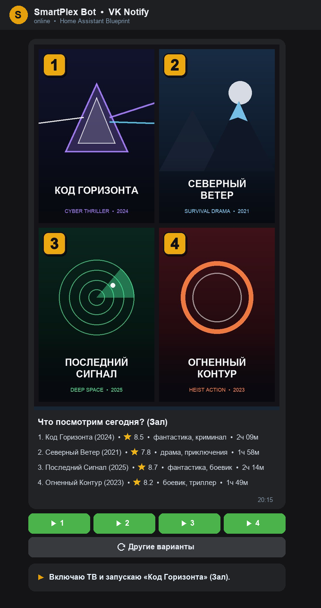
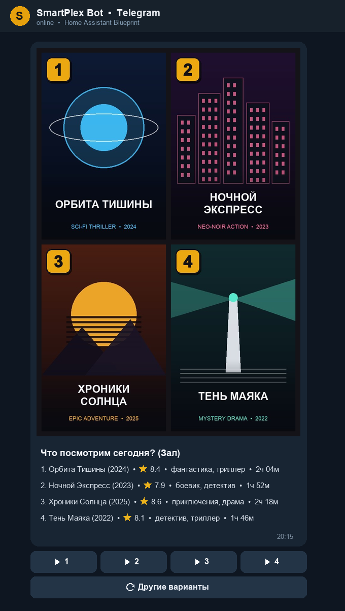

# Blueprints и примеры UI-автоматизаций Кинорулетки

## 1. Рекомендуемый способ — готовые Home Assistant Blueprints (100% через UI)

Скопируйте файлы из папки [`../blueprints/automation/Eugen417/`](../blueprints/automation/Eugen417/) в каталог `/config/blueprints/automation/Eugen417/` вашего Home Assistant (или импортируйте по URL после публикации репозитория), затем перейдите в **Настройки → Автоматизации и сцены → Чертежи (Blueprints)**:

* [`smartplex_vk_movie_roulette.yaml`](../blueprints/automation/Eugen417/smartplex_vk_movie_roulette.yaml) — интерактивная вечерняя Кинорулетка для **VK Notify** (`notify.vk_notify_*`, снэкбары ВК, нативная инлайн-клавиатура `roulette.vk_keyboard`).
* [`smartplex_telegram_movie_roulette.yaml`](../blueprints/automation/Eugen417/smartplex_telegram_movie_roulette.yaml) — интерактивная вечерняя Кинорулетка для **Telegram Bot** (`notify.telegram_bot_*` в Home Assistant 2026.9+).

  
  &nbsp;
  

> 💡 **Никаких правок `configuration.yaml` не требуется:** коллаж отдаётся напрямую из памяти через защищённый локальный HTTP-вью с короткоживущей подписанной ссылкой (`roulette.image_url`, без записи файлов в `/config/www` и без настройки `allowlist_external_dirs`), а проверить отправку можно в любой момент кнопкой **«Выполнить действия»** в карточке автоматизации.

---

## 2. Альтернатива — чистые YAML-автоматизации

Готовые автоматизации для прямой вставки (*Настройки → Автоматизации → Создать автоматизацию → Редактировать в YAML*):

1. [`vk_movie_roulette.yaml`](vk_movie_roulette.yaml) — афиша в **VK Notify** (`vk_notify.send_photo` + `vk_notify_callback`).
2. [`telegram_movie_roulette.yaml`](telegram_movie_roulette.yaml) — афиша в **Telegram Bot** (`telegram_bot.send_photo` + `telegram_callback`).

Перед сохранением укажите свою сущность `notify_entity` (`notify.vk_notify_*` или `notify.telegram_bot_*`), пресет `default_preset` и зону `default_zone` в блоке `variables:` в начале файла.

---

## 3. Полный справочник команд и служб

Примеры голосовых фраз и YAML-вызовов для фильмов, сериалов, музыки, переноса между комнатами, паузы, перемотки (`±сек/мин`, точная минута), повтора и микса собраны в **[`../docs/COMMANDS.md`](../docs/COMMANDS.md)**.
