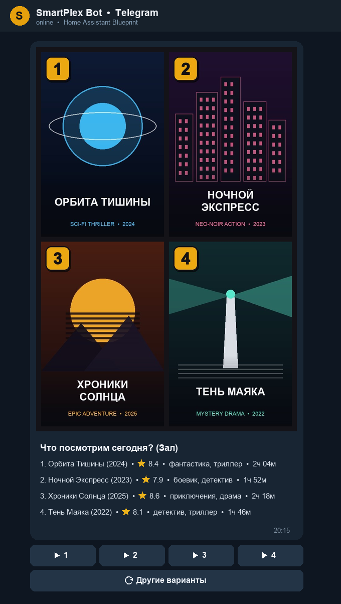
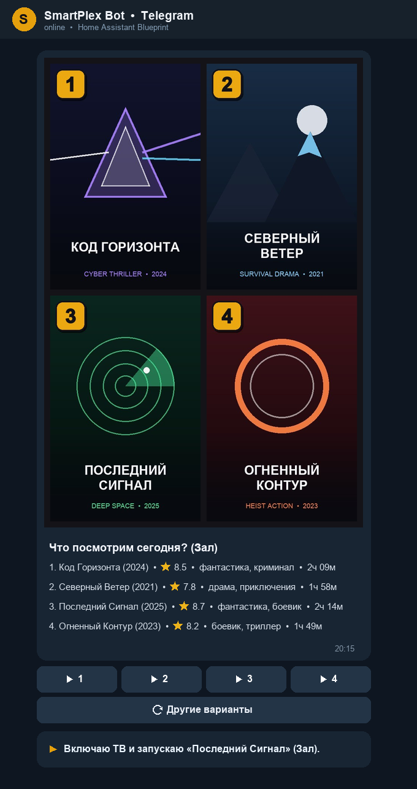

# SmartPlex Movie Roulette Blueprints & YAML Examples

## 1. Recommended — Home Assistant Blueprints (100% UI Setup)

Copy [`../../blueprints/automation/Eugen417/smartplex_telegram_movie_roulette_en.yaml`](../../blueprints/automation/Eugen417/smartplex_telegram_movie_roulette_en.yaml) into `/config/blueprints/automation/Eugen417/` on your Home Assistant instance, then open **Settings → Automations & Scenes → Blueprints** to pick your `notify.telegram_bot_*` chat entity, schedule time, preset, and target zone right from the UI.

  
  &nbsp;
  

> 💡 **Zero `configuration.yaml` edits required:** SmartPlex serves the poster collage from memory over its authenticated `roulette.image_url` endpoint using short-lived signed URLs (no `/config/www` files and no `allowlist_external_dirs` needed), and you can test the showcase anytime via **Run actions** in the automation menu.

---

## 2. Standalone YAML Automation

Ready-to-paste Home Assistant automation (*Settings → Automations → Create Automation → Edit in YAML*):

- [`telegram_movie_roulette.yaml`](telegram_movie_roulette.yaml) — evening Movie Roulette poster showcase in Telegram Bot (`notify.telegram_bot_*`, Home Assistant 2026.9+) with inline Play & Reroll buttons.

Update `notify_entity`, `default_preset`, and `default_zone` under the top `variables:` section before saving.
